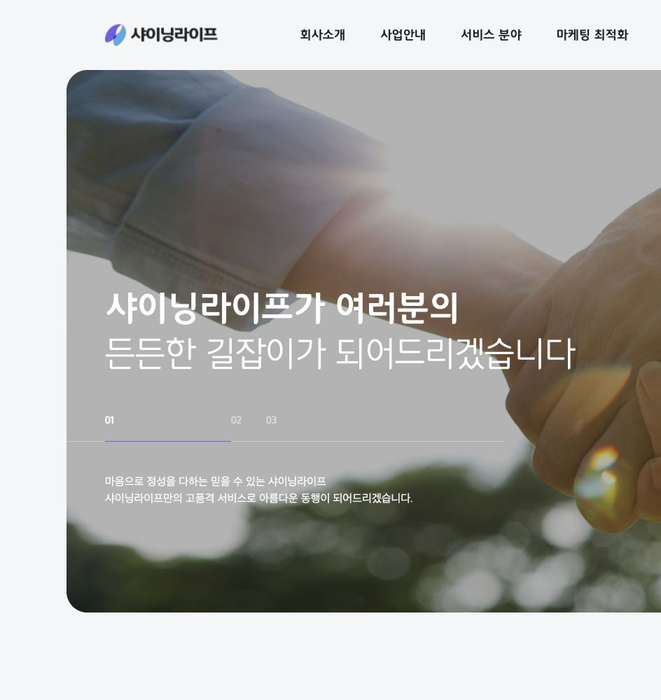
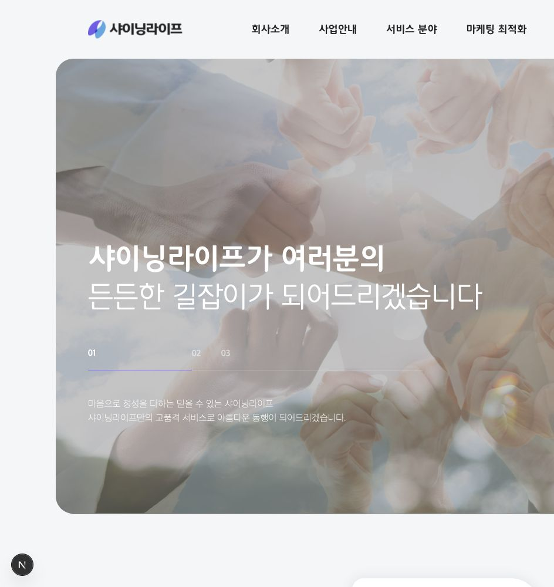
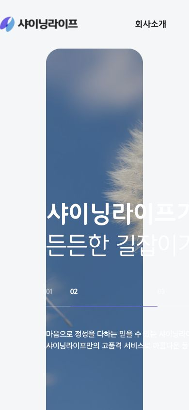
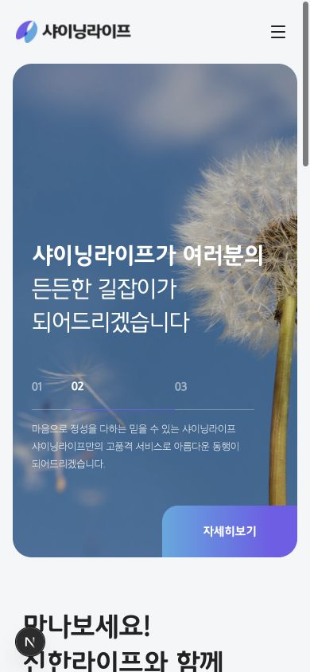

# 샤이닝 기업 홈페이지 메인 복제

## 범위와 파일 소유

| 원본 | 로컬 | 구현 |
| --- | --- | --- |
| https://co1108.shiningcorp.com/index.php?device=pc&designkits=1 | /index.php?device=pc&designkits=1 | src/app/index.php/page.tsx |
| 같은 메인의 기본 진입점 | / | src/app/page.tsx |

공유 구현: `src/components/sites/shining/home.tsx`, `home.module.css`.
전역 폰트 및 초기화: `src/app/globals.css`. 메타데이터: `src/app/layout.tsx`.
원본 링크 중 상세 페이지, 게시판, 로그인, 회원가입, 법적 고지는 요청 범위 밖이므로 원본 주소로 연결한다. 로그인이나 보험 조회 백엔드는 구현하지 않았다.

## 원본 관찰

- 고정 헤더: 높이 100px, 내부 폭 1140px. 메뉴 진입 시 전체 하위 메뉴 노출.
- 메인: 좌우 95px, 상단 100px, 높이 775px, 모서리 30px. 배경 이미지 3장, cover/center.
- 제목: LotteMartDreamLight 50px / 1.3; 첫 줄 Bold. 제목 상단 308px.
- 슬라이드: fade 1000ms, 자동 재생, 01~03 선택. 원본 delay 3500ms와 전환 시간을 고려하여 로컬 반복 주기를 4500ms로 구성.
- 본문: 1140px, 위 110px / 아래 60px. 소개 376px, 카드 320×350px, 카드 열 간격 50px, 오른쪽 열 50px 어긋남.
- 빠른 조회 → 그라데이션 통계 배너 → 공지사항/자주하는질문 → 회색 푸터.
- 원본 폰트 중 LotteMartDream Light/Medium/Bold 파일 3개와 이미지 14개를 확보했다. 실제 파일 형식 확인. 전체 매핑은 assets.json.
- 원본 PC URL은 390px 화면에서도 고정 폭으로 잘린다. 로컬은 760px 이하에서 모바일 메뉴와 2열 카드, 세로 섹션 배치로 조정했다.

## 검증

- `PATH=/opt/homebrew/bin:$PATH npm run check` 성공: ESLint, TypeScript, Next.js 프로덕션 빌드.
- 두 로컬 경로 모두 브라우저 렌더링 확인.
- 1440px 데스크톱에서 원본과 히어로 위치, 제목 크기, 여백 비교.
- 390px 모바일 메뉴 열기/닫기, 슬라이드 직접 선택, 맨 위로 이동 확인.
- 390px / 1440px / 1920px에서 document.scrollWidth가 viewport 폭과 같음.
- 페이지 이미지 누락 0개. 확인한 브라우저 로그에 런타임 오류 없음.
- 원본 SupahScroll의 관성 스크롤은 브라우저 기본 스크롤로 대체. 섹션은 IntersectionObserver로 진입 애니메이션 적용. 본문 작은 글씨는 원본에서 선언했으나 확보되지 않은 notokr 계열 대신 시스템 한글 폰트 사용. 애니메이션 캡처는 전환 프레임이 포함될 수 있음.
- 기본 셸의 Node는 18이라 Next 실행 불가. 설치된 `/opt/homebrew/bin/node` (25.6.1)로 검사했다. 기존 개발 서버는 포트 3000을 사용 중이며 재사용했다.

## 시각 참고

데스크톱 원본:

데스크톱 로컬:

모바일 원본(PC 고정 폭):

모바일 로컬:

## 권리 검토 메모 — 2026-11-01

공개된 원본에 `ⓒ 샤이닝 - 기업 홈페이지 샘플` 표시가 있다. 푸터의 실제 팝업 URL `/sh_page/sh_stipulation.php`를 확인했으나 본문은 `해당 홈페이지에 맞는 회원가입약관을 입력합니다.`라는 안내용 문구였다. `/robots.txt`는 404였다. 확인한 범위에서 복제·수집 금지 실질 조항이나 상업적 재사용 허락을 확인하지 못했다. 운영사의 별도 제작계약·상품별 이용조건과 제3자 권리까지 확인된 것은 아니다.

이 결과는 복제 허용의 증거가 아니다. 법정 저작권은 별도의 금지 고지가 없어도 적용될 수 있다. 텍스트/사진/영상/로고 교체 후에도 창작적인 화면 표현이나 코드가 남으면 침해 쟁점이 남을 수 있다. 현재 로컬 결과는 원본 자산을 포함한다. 상업 공개 전에 디자인 사용허락 및 에셋 라이선스 범위를 확인하거나, 일반적인 기능만 참고해 독립적으로 재설계해야 한다. 운영사 허락이 제3자 자산 권리까지 포괄하는지도 별도로 확인한다. 자동수집 허용 여부 또한 robots.txt의 부재만으로 확정할 수 없다.

참고: [원본](https://co1108.shiningcorp.com/index.php?device=pc&designkits=1), [약관](https://co1108.shiningcorp.com/sh_page/sh_stipulation.php), [저작권법 제16·18·22조](https://law.go.kr/lsLinkCommonInfo.do?chrClsCd=010202&lsJoLnkSeq=1025203483), [수정 후 복제·실질적 유사성 관련 판례](https://www.law.go.kr/LSW/precInfoP.do?precSeq=225201).

본 메모는 공개자료에 기초한 예비 검토이며 구체적 적법성 확정 의견은 아니다.
